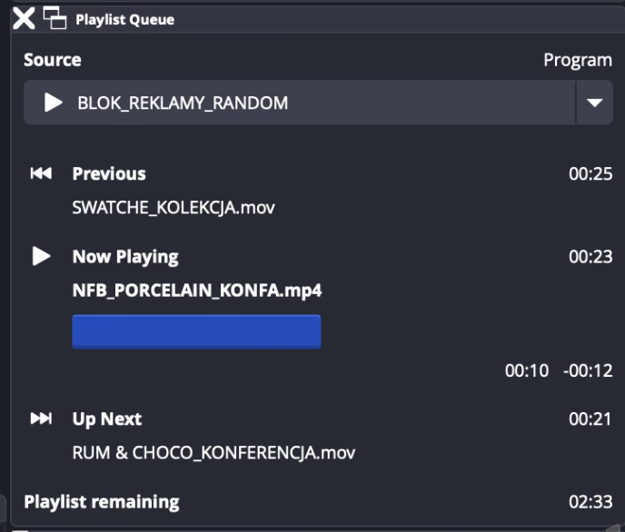
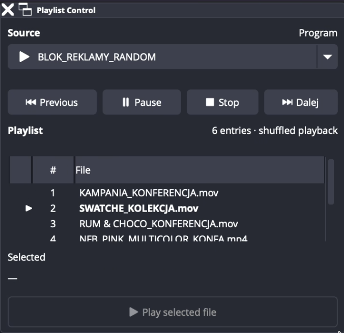

# Media Playlist Source

An enhanced and actively maintained OBS Studio plugin for media playlists, built on OBS Media Source. It provides playlist behavior similar to VLC Video Source while keeping playback inside OBS Media Source.

  

  

## About this fork

This is an independently maintained fork of [CodeYan01/media-playlist-source](https://github.com/CodeYan01/media-playlist-source), maintained by Vencite.

The fork started as a production-focused fix for visible gaps between playlist items, introducing dual-source A/B playback with preloading for seamless transitions. It also includes corrected decoder audio routing and additional reliability and workflow improvements for live OBS use.

The original plugin was created by Ian Rodriguez / CodeYan01.

## Features

- Play local files, folders and FFmpeg-supported URLs, with seamless A/B video transitions and OBS mixer audio control.
- **Playlist Queue:** Previous, Now Playing and Up Next, progress and remaining time. The playlist countdown is hidden while Loop is on.
- **Playlist Control:** browse and start individual entries, with an optional playback toolbar.
- **Right-click options:** Follow Program MPS, Shuffle and Loop in both docks.
- Shuffle with playback history and optional fresh shuffle on activation.
- Optional folder monitoring with filename/date sorting and file-stability checks.
- Edit playlists during playback, remember the current entry across OBS restarts, and integrate through obs-websocket.

## Installation

Download the latest Vencite build from the [GitHub Releases page](https://github.com/Vencite/media-playlist-source/releases).

Current releases provide builds for:

- Windows x64: installer and portable packages.
- macOS: universal package for Apple Silicon and Intel Macs.
- Linux x86_64: Debian package.

The current build configuration targets OBS Studio 31.1.1 and the fork is tested on OBS Studio 32.

## Limitations

- The current filename in Properties does not refresh continuously; reopen the window to update it.
- Choosing between embedded audio or subtitle tracks (e.g. different languages) is not supported.
- File-stability checks help avoid unfinished copies, but cannot guarantee completion.

## WebSocket integration

Use MPS data in tools such as Companion:

- **Read:** current filename, playback state, elapsed time, file duration, playback speed, remaining file/playlist time, and playlist entries.
- **Control:** select a playlist entry, set Shuffle/Loop, or use OBS's standard media actions for play, pause, stop, next, previous and seek.

Enable **Tools → WebSocket Server Settings** in OBS and connect your client. In Companion, use an **OBS Studio** connection with **Custom – Send Vendor Request**, vendor `media-playlist-source`. For example, `GetPlaylistState` with `{"source_name":"My Playlist"}` reads that source's state.

Other obs-websocket v5 clients use `CallVendorRequest`. See the [API reference](docs/playlist-telemetry.md) for requests, live events and handling unknown times. API playlist time describes the current pass, including when Loop is enabled.

## For developers

See [integration notes](docs/developer-integration.md) for source settings, playlist IDs and the legacy native selection procedure, or the [WebSocket API](docs/playlist-telemetry.md) for external clients.

## Development and testing

Development of this fork uses AI-assisted coding tools where useful, but changes are reviewed, compiled in CI, and validated in OBS before being relied on in production.

Release validation notes are kept in [docs/release-notes](docs/release-notes), and the manual regression checklist is available in [tests/manual-regression.md](tests/manual-regression.md).
